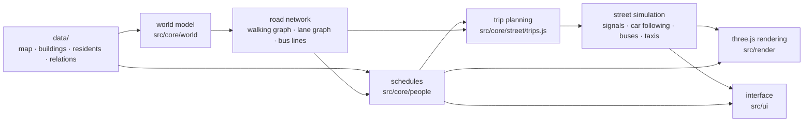

# 彥彥的小鎮 Yan's Little Town

**English** | [繁體中文](README.md)

**A little town of more than a thousand residents, living each day in real time in your browser.**

**🔗 Live demo: <https://yuyan7498.github.io/yans_little_town/>** (nothing to install; works on phones too)

Every resident has a home, a job, family and friends, and follows their own week: off to work or school in the morning, lunch at noon, the night market after work, family outings at the weekend. They walk, cycle, ride scooters, drive, take the bus or a taxi, wait at red lights, sit down to eat at the night market and go home to sleep. Tap any building to see who is inside right now; tap any resident to see their day and their relationships, and follow them wherever they go.


- **No build step, no dependencies**: plain HTML + JavaScript + three.js; any static server will do
- **1175 residents, 28 days without a repeat**: everyone's week is derived from rules, and the same data gives exactly the same town in any browser
- **An airport and a zoo**: the town airline's planes take off and land 16 times a day, crewed by townspeople, and fade away in the distance once they leave the town; at the zoo, elephants, giraffes, capybaras and the rest stroll in groups, nap where they stand and lie down to sleep after closing
- **They really "go there"**: every trip finds its way over the real road network, takes real time and arrives on time — no teleporting
- **Streets with physics**: car following, traffic lights, exclusive pedestrian phases, yielding to pedestrians, bus stops, shared taxis
- **Everything is editable**: residents, families, the map, buildings and bus lines all live in `data/`; edit, reload, done
- **Purely procedural art**: not a single 3-D model file is loaded — people, vehicles, buildings and fireworks are all drawn in code, down to blue-and-white slippers, yellow kindergarten caps, red-white-and-blue woven bags and iron window grilles

> The town is set in Taiwan: the interface, the residents' profiles and the data are in Traditional Chinese.

---

## Contents

- [Quick start](#quick-start)
- [Gallery](#gallery)
- [A tour of the town](#a-tour-of-the-town)
- [The residents](#the-residents)
- [Road network and pathfinding](#road-network-and-pathfinding)
- [Street simulation: traffic physics and signals](#street-simulation-traffic-physics-and-signals)
- [Rendering and performance](#rendering-and-performance)
- [Interface and controls](#interface-and-controls)
- [Build your own town](#build-your-own-town)
- [Development](#development)
- [About the resident data](#about-the-resident-data)
- [License and credits](#license-and-credits)

---

## Quick start

To just look around, open the [live demo](https://yuyan7498.github.io/yans_little_town/); to run or change it on your own machine:

```sh
git clone https://github.com/yuyan7498/yans_little_town.git
cd yans_little_town
npm run serve        # opens http://127.0.0.1:8123
```

- All you need is **Node 22 or later**, and only the dev server, the tests and the tools use it; the town itself is pure front end.
- No Node? Serve the folder with any static server (e.g. `python -m http.server`).
- It runs on phones too: small touch screens switch to a lighter quality automatically.

### URL parameters

| Parameter | Effect |
|---|---|
| `?day=6&minute=1230` | Jump straight to day 6 (Saturday) at 20:30. `day` starts at 1, and day 1 is a Monday; `minute` is 0–1439 |
| `?dayspeed=8` | Run time 8× faster (up to 60×) |
| `?quality=lite` / `?quality=full` | Force the phone / full quality |
| `?welcome=0` | Skip the welcome screen |
| `?debug` | Put `town`, `view`, `ui`, `world`, `people` and `street` on `window` for debugging |

Without a time in the URL, the town remembers where you left off (in the browser's localStorage) and carries on from there next time.

---

## Gallery

| | |
|---|---|
|  |  |
| **Friday 20:24**: the street lights are on, windows light up as residents come home, and fireworks burst over the canal | **Riverside night market**: 32 stalls, residents sitting down to eat, and Tangerine the stray cat begging beside the stalls |
|  |  |
| **Town airport**: tap Town One as it sets off and the camera follows it as it taxis, takes off and climbs away; on board are the captain, first officer and flight attendant on duty | **Town zoo**: on a Saturday afternoon a mother elephant walks with her calf while the bull eats hay under the shelter; behind them capybaras soak in a hot spring (one with a yuzu on its head), and the male lion sits on his rock at top right |


**Following a resident**: tap a resident riding a scooter home and the camera follows all the way; the card on the right shows their job, shift, days off, relationships, personality and today's schedule.

---

## A tour of the town

The town is a near-square 596 × 552 board with a north–south canal down the middle. Six north–south avenues and seven east–west streets make up the road network, with a row of outer lots on each of the east and west sides, mirroring each other:

- **The canal and its promenades**: a 12-wide promenade with railings and lanterns on each bank; the water has an animated shader and reflects the lanterns at night
- **Bridges and tunnels**: the North Outer Road, North Street, South Street and South Outer Road cross the canal on arched bridges; the North and South Ring Roads dive under it through **tunnels** (deep enough for buses, and lit inside)
- **Two arched footbridges**: the North and South Footbridges
- **Central Street pedestrian zone**: between the two embankment avenues only pedestrians may go
- **Outer ring roads**: let buses and lorries go round the whole town without gridlock; the West and East Outer Roads then enclose the outer lots
- **Landmarks on two lots**: Central Street stops at the east and west ring roads, so the airport and the zoo each take up two lots

### Buildings

| Category | Buildings |
|---|---|
| Homes | Courtyard houses, a garden tower block, terrace flats and a twin-tower estate (balconies, window grilles, air-conditioner units and rooftop water tanks included; all four are **exactly full**), plus two luxury estates: **Cloudtop Villas** (雲頂別墅; six modern villas with pools and a guardhouse) and **Tianxi Residences** (天璽豪宅; 24 storeys, a sky garden and a crown that lights up at night) |
| Schools | Zhendong Elementary School (with a kindergarten), Future High School, Town University |
| Health | Town General Hospital (an ambulance at the A&E entrance) and three community clinics |
| Shopping and food | Galaxy Department Store (LED ticker), South Lane Mall (clock tower), the **riverside night market**, the wholesale fruit and vegetable market |
| Offices | North Office Tower (helipad on the roof), the Bank Business Tower, East Bank Office Tower, the community office building, Zhenbei Bank, and the **Town Bank head office** (stone-pillared portico, 24-hour ATM, drive-through ATM) |
| Public services | Town Hall, the town library, Zhendong Police Station, the sanitation team, and the **town fire station** (fire engine, aerial ladder truck, ambulance and a five-storey training tower) |
| Transport | The bus terminal, the **town airport**, and the **West** and **East petrol stations** (fuel price boards, convenience stores, automatic car washes; the cars at the pumps are residents filling up) |
| Industry | The craft workshops, Zhenbei Logistics Centre |
| Leisure | City Light Plaza, Starlight Park (an amusement park), West Bank Park, East Bank Park, the town sports ground, the **town zoo**, **Starry Sky Cinema** (marquee lights and film posters) and **Zhen'an Temple** (鎮安宮; swallowtail roof ridges, jiannian porcelain mosaics, a Heaven censer and rows of red lanterns) |

### Landmarks and daily events

| Landmark | What happens |
|---|---|
| 🏮 **Riverside night market** | Open 18:00–24:00 with 32 stalls along both banks of the canal (oyster omelettes, bubble tea, popcorn chicken, takoyaki… and balloon darts) and 140 seats. Stall owners always mind the stall their job title names: the "braised snacks stall owner" runs the braised snacks stall |
| 🎆 **Fireworks** | Every night 19:30–20:30 over the canal: five kinds of shells (peony, ring, willow, crackle, double layer) plus a 13-shot finale. Every night's show is different, and it is a pure function of time: drag the time bar back and the sky replays exactly the same fireworks |
| ⛲ **City Light Plaza** | The fountain runs 06:00–23:00, with a 26-minute coloured water show at 18:30, 20:40 and 22:00 |
| 🎡 **Starlight Park** | A 16-gondola Ferris wheel (the gondolas always stay level), a carousel, swing ride and roller coaster; the wheel's rim has chasing lights at night |
| 🚁 **The president's helicopter** | The president flies out on patrol three times a day from the roof of North Office Tower (weekdays 08:40, 13:10, 16:50; weekends 10:20, 14:20, 17:50). Take-off, circling, banking into turns and landing are all computed physically, and you can tap it to follow |
| ✈️ **Town airport** | The town airline's two turboprops fly four round trips a day each (from 07:00, to and from Penghu, Kinmen, Taitung and Matsu): engine start, pushback, taxi, holding at the runway threshold, take-off roll, gear up and climb, then a slow fade into the haze once they leave the town; on the way back they slowly appear out of the distance, land from the south and taxi back to the stand. At night they show navigation lights, strobes and landing lights. You can tap a plane to follow it, and the crew on duty is on board (the selection clears by itself when the plane fades out); at weekends plenty of families come to watch the planes |
| 🦒 **Town zoo** | Open 09:00–17:00: elephants, giraffes, lions, zebras, hippos, capybaras, flamingos and monkeys each have their own enclosure. The calf stays by its mother while the bull eats hay under the shelter; the zebras, the monkeys chasing round their climbing frame and the capybaras soaking in their hot spring walk round in single file; at nap time and after closing they lie down to sleep right where they stopped. Keepers arrive at 07:30 to feed the animals, and weekends bring the most family visitors |
| 🎈 **The advertising airship** | Circles over the town with "彥彥的小鎮 / By 彥彥" on both sides, in neon at night |
| 🏟️ **Town sports ground** | A running track, pitches and stands; four floodlight towers come on with the street lights |

---

## The residents

The town has **1175 residents**: 1173 people, plus a stray cat, Tangerine (橘子), and a stray dog, Oden (黑輪).

### Who lives here

| Who | Count | Roughly how their day goes |
|---|---:|---|
| Preschoolers | 48 | On weekdays a parent drops them at the elementary school's kindergarten on the way to work, out at 16:00; at weekends, after a nap, a grown-up pushes them to the park in a stroller |
| Elementary pupils | 91 | School 08:00–16:00; a quarter go to the amusement park after school, and some are met at the gate by a grandparent |
| High-school students | 63 | School 07:30–17:00, evening study Monday to Thursday (or regular evenings at the library), some go to the department store on Fridays |
| University students | 77 | Everyone's timetable has a different shape every day; over half have dinner at the night market two fixed days a week, and they sleep in till ten at weekends |
| Office workers | 156 | About 09:00–18:00, each with their own flexible hours; one day of overtime a week, and some towers work every other Saturday |
| Tower night shift | 12 | On duty 22:00–07:00, sleeping in the daytime |
| Workshop, logistics and market workers | 104 | The market has a 04:00 wholesale shift and a 07:30 retail shift |
| Shop staff, stall owners, petrol station and cinema staff | 108 | Shop staff work early or late shifts; stall owners prep from 16:00 and sell 18:00–23:20; the petrol stations, the cinema, the temple and the zoo shop all have someone minding them |
| Drivers | 32 | 19 of them drive buses, in early and late shifts, every day of the year |
| Aircrew | 18 | Six crews (captain, first officer, flight attendant) take turns, two round trips per duty, roughly two days on and one off |
| Airport ground staff | 14 | The early shift sees off the first flight at 05:30; the late shift stays until the last one lands, at 21:30 |
| Zoo keepers | 10 | Feeding starts at 07:30; the zoo opens every day, and they take turns to rest |
| Teachers and school staff | 37 | The elementary school, high school and university each keep their own hours |
| Doctors, nurses and hospital administrators | 60 | Doctors and nurses work three shifts (early, evening, night), with a meal on the evening shift |
| Police officers | 8 | Three shifts; on school days early-shift officers stand **school-crossing guard** at the elementary school gate from 15:15 |
| Firefighters | 15 | On standby at the fire station in three shifts; the early shift drills in the afternoon |
| Bank clerks and town hall staff | 34 | Half of Zhenbei Bank's staff work Saturday mornings, swapping every other week; the Town Bank head office opens on weekdays only |
| Sanitation team | 10 | Collect rubbish at dawn; the evening shift also cleans the riverbank after the night market closes, until 00:40 |
| Between jobs | 11 | Sleep till ten; some queue at the town hall two afternoons a week |
| Hospital in-patients | 6 | Treatment twice a day, a walk along the corridor in the afternoon |
| Retirees and elders | 257 | Morning exercise, the market on Tuesdays, Thursdays and Saturdays, doctor's visits, chess and chat on the benches in the afternoon; some dance in the square at night, and some visit Zhen'an Temple two mornings a week |
| The mayor and the president | 2 | Hand-written schedules of their own (see below) |
| Stray cat and stray dog | 2 | Never enter buildings, roam the whole town (see below) |

### Relationships

- **333 households** (couples, multi-generation homes, flat shares, singles); 906 residents belong to one
- **2591 relationships**: 170 partners, 111 long-time spouses, 594 parent–child, 215 siblings, 271 grandparent–grandchild, 56 roommates, 410 close friends, 176 old friends, 142 classmates, 429 coworkers, 16 people caring for the strays, and one mayor with a fiancée
- **41 grandparent school pick-ups**, **127 groups of close friends**, **99 circles of old friends**
- The interface's words for relations (partner, parent, coworker…) are all neutral and **never guess anyone's gender**; appearance is not decided by gender either: hairstyle, skirt or trousers, build and colours are all independently random

### Going out together

Residents don't live separate lives. Each day `src/core/people/together.js` first decides what every household and group of friends does together, and everyone taking part gets **exactly the same minutes, place and party number**, which no later time tweak can break apart; the walking time is set by the slowest member.

- **Family days**: when a child and at least one parent are free, there is a 70% chance at the weekend that the family goes to the amusement park, the zoo, the department store, the cinema, a park or the plaza (some go to the airport to watch the planes), and nearly half go on to the night market together in the evening
- **Couple days**: when both are off and any children are 12 or older, there is a 50% chance they have dinner together at the night market, or go out in the afternoon for a walk, a film or the zoo
- **Kindergarten runs**: in each household, the first adult who "works today, at an office, workshop, logistics centre, bank, the town hall or in hospital administration" drops the child off on the way and picks them up on the way home; without one, a family member who is off that day or a grandparent does it
- **Grandparents at the school gate**: on school days they wait at the gate at 15:50 and walk home hand in hand with their grandchild; if the child is going to the amusement park after school, the grandparent goes too (both schedules ask the same hash, so they always agree)
- **Friday dinners with friends**: every group of close friends eats together two Fridays out of three, 70% of the time at the night market
- **Circles of old friends**: retirees and elders sit on the nearest bench that seats the whole circle five afternoons a week to chat; if the bench is beside a chess table it becomes a chess game. Two circles sharing a bench take turns
- **The mayor's dates**: the mayor and their fiancée have dinner at the night market every Monday, Wednesday and Friday, and spend whole weekends together at the plaza, the department store and the night market; the fiancée's overtime automatically avoids those days
- **Dog walking**: the 16 dog owners walk their dogs for 20–40 minutes every morning and evening, the dog on a lead ahead of its owner; a retired partner comes along
- **Night market seats**: people who came together sit together; when the seats are full they stand in front of the stalls. If a seat can only be reached by going round a table, residents really walk round

### Tangerine the stray cat and Oden the stray dog

Their nests are on the riverbank in front of the town hall: a cardboard box with a towel and a little lantern, and a kennel with a red roof.

- **Tangerine** is a night owl: sleeps and suns in the nest by day, always gets to the night market before 19:00 to beg from the stall owners (fed about two times in three), then prowls the whole town all night and **only walks home at two or three in the morning**
- **Oden** gets up at five, waits at the nearest park or plaza by 06:30 for the elders doing morning exercise to share breakfast, wanders the town by day, goes to the school gate, the amusement park or the plaza to play with the children when school lets out, and is back in the kennel by 21:30
- Roaming: the map is cut into a 4 × 8 grid; each animal has its own shuffled order of cells and favours 5 of them each day, so over a week they cover the whole town
- They have "people who look after them" too: 16 in all, stall owners, retirees, students and the mayor

### The mayor and the president

- **The mayor, 彥彥 (Yan Yan)**: at the town hall 08:30–17:30, visits the market, the elementary school, the parks, the bus terminal and the hospital in turn on Tuesday and Thursday afternoons, ends every day at the night market, and commutes by scooter
- **The president**: enters North Office Tower at 07:45 every day for affairs of state, is on board every helicopter patrol, every day of the year

### The aircrew and the new jobs on the outer lots

- **Aircrew**: 18 residents form six crews of three (captain, first officer, flight attendant) and take turns flying the roster in `src/core/world/flights.js`: on a duty day they get to the airport early for briefing, board, fly two round trips, debrief and go home. From pushback to parking on the stand, tap a crew member and they are on the plane; follow them and you follow the plane through take-off, departure, the return and landing
- **Refuelling**: residents who drive themselves fill up at the petrol station nearest home two days a week, on the way home from work (or on a morning off)
- **The temple, the cinema, the zoo**: elders visit Zhen'an Temple two mornings a week; students, couples and families go to Starry Sky Cinema or the zoo at weekends

### How schedules are made

Schedules aren't written person by person; they go **occupation → day template → a chain of adjustments**:

1. **Occupations split finer**: workers split by where they work (market, logistics, workshop); shop staff into shops and night market stalls
2. **Templates**: one function per occupation, producing rows of `[start, end, state, place code, activity]`, e.g. `['08:00','12:00','AT_WORK','WORK','class']`
3. **Shared plans** go in first (family days, school runs, dinners…)
4. **Place codes → real places**: `NIGHT_MARKET`, `MALL`, `CLINIC`, `BENCH`… resolve to the nearest one from each person's home (parks and plazas pick the second nearest 35% of the time, so not everyone crowds into the same one)
5. **Natural spread**: getting up and meals ±15 minutes, leaving home ±30 minutes, and office workers have their own fixed flexitime of ±30 minutes, so the town never leaves home in the same second
6. **Room for the journey**: every trip is stretched to the real door-to-door travel time plus 8 minutes' slack, pushing the stays before and after if needed; sleep never drops below about 6 hours
7. **Closed places**: a plan pointing at somewhere closed (the bank on a Sunday, say) turns into staying home
8. **Crowd control**: people per place are counted in 5-minute slots; plans that can change place queue by start time, and the whole party moves together to the first place that still has room (the night market may fill to 130%)
9. Shifts across midnight are cut in two; the next day starts with "continuing last night's shift", and only if they really worked yesterday

**Days off** are automatic too: shop staff get two weekdays off in a row (so there is always someone in the shop at weekends), medical staff, police and drivers two days in a row, and members of a team are staggered so someone is at work every day.

### Determinism: the same data, always the same town

There is **not a single `Math.random`** in `src/core`. Every "random" choice hashes a string (FNV-1a plus a murmur-style mix), such as `residentId:habitName:dayNumber`:

- `has`: long-term personality (the same people every week)
- `today`: today's whim
- `onDays(n)`: n fixed weekdays every week
- `weekly`, `alternate`: the same day every week, every other day

So with the same data, in Node, Chrome or on a phone, everyone does exactly the same thing every day; the test `plans are deterministic` checks this. Some rotations run by the week (Saturday bank duty, weekend duty, overtime days, alternate Saturdays, the mayor's three-week round of visits), which is why the checker plans all **28 days**.

### Who is where, and why the windows light up

- `occupancy(day, minute)` binary-searches the 1175 schedules to get who is in each building right now, how many are awake and how many are at work; it is exactly the list you see when you tap a building
- **The share of lit windows comes from residents who are really at home and awake**: at night most windows are dark, but about 6% of homes have someone up late; office towers with a night shift stay lit at midnight

### A profile for every resident

Every resident has a short bio, plus a personality, interests, a catchphrase, a little goal for now and a **little secret** that only shows when you tap it.

---

## Road network and pathfinding

### From map to graph

`data/town.js` is the only file with coordinates; the world model (`src/core/world/build.js`) derives everything from it:

| Item | Count |
|---|---:|
| Road nodes | 74 (40 junctions) |
| Road segments | 100 (4 on bridges, 2 in tunnels) |
| Signalled junctions | 32 / 40 (the outer corners are bends, and the four corners of the old outer ring are quiet and unsignalled), plus 8 signalled mid-block crossings |
| Zebra crossings | 140 at junctions + 8 mid-block |
| **Walking graph** | 488 nodes, 638 edges (462 pavement, 148 zebra, the promenades, footbridges…) |
| **Lane graph** | Shares the 74 road nodes, 98 two-way segments (196 directed arcs) |
| Bus stops | 120 stop positions, 86 stop poles, 62 of them with shelters |

Traffic keeps right; there are no one-way streets. Lane positions follow from the road width: cars use the inner or outer lane, scooters and bicycles keep to the kerb.

### Walking: a Dijkstra tree from every door

- The walking graph is stored as **CSR (compressed sparse row)** typed arrays and the priority queue is a reused **binary min-heap**, so a search allocates no memory
- Every door gets a forward and a backward **Dijkstra shortest-path tree**, cached; after that the route between any two doors is an O(1) lookup
- A search can start halfway along an edge: both end nodes enter the heap with their partial cost
- **Cost** = length × keep-right factor + zebra penalty
  - Walking on the "wrong" side of the pavement costs 3% more (`KEEP_RIGHT = 0.03`), so pedestrians naturally keep right
  - Every zebra crossed adds 10 units (`CROSS_PENALTY = 10`), so nobody zigzags across the road to save a step
- **Zebras only**, guaranteed three ways:
  1. When the graph is built, the pavement is cut at every carriageway junction and only zebras join the pieces
  2. When a door is joined to the network, Liang–Barsky line clipping checks the link never crosses a carriageway
  3. A test samples every route every 0.5 units and checks nobody ever steps on a carriageway
- The graph is small enough that A* isn't needed; Dijkstra with caching is fast enough

### Driving: point-to-point Dijkstra and kerbside stops

- A search starts from "a point on the kerb, facing a direction" and ends at "another kerb point", stopping as soon as it arrives; U-turns are banned at both ends, so a car will go round the block if it must
- **Where to get in and out**: each door takes candidate kerb points within 110 (the nearest side on foot, the opposite side of the same road, the best point on another road), every origin–destination pair is tried, and the score = driving cost + 12 × walking distance
- **Kerbside bays**: kerbs where stopping is allowed are cut into 6.5-long bays, none near bus stops, and one bay in four is kept for taxis. Every stop books a time window in a ledger; when the bays are full the car goes to another spot at most 30 units further to walk, and once booked the route is re-planned to the actual bay
- **Lane choice**: the route is merged into one run per road and every turn is classed left, right or straight; cars move to the inner lane before a left turn and keep to the outer lane for straight on, right turns or a last stretch that ends at the kerb, changing lanes at the latest point clear of junctions and zebras

### Routes that avoid congestion

Every **directed** segment has a day-long flow table in 10-minute slots (145 slots, a `Float32Array`):

```
segment cost factor = 1 + 2 × (flow / capacity)²     ← like the BPR congestion function
flow                = this slot + half of each neighbouring slot
capacity            = 0.25 × speed factor × lanes
```

All of a day's trips are **sorted by arrival time and assigned one by one**: each trip writes the segments it uses back into the flow table, so later travellers naturally route round the jams earlier ones made. Which slot to read is decided by first estimating, at free-flow speed, "roughly when it will be on that segment". A scooter counts as 0.35 of a car.

### Choosing how to travel

| Distance | Choice |
|---|---|
| Within 110 and walkable | Walk (people with dogs and the strays always walk) |
| Within 280 | Everyone in the party cycles, and the person is a cycling fan (about 55%) or usually cycles → bicycle |
| Anything else | The "usual mode" for their role: office workers about 52% scooter, 24% car, 14% bus, 10% bicycle; elders 65% bus, 20% taxi, 15% driven by family; elementary pupils 30% driven by family, 70% bus; the mayor always rides a scooter |

Parties of three or more prefer a car, bus or taxi; parties of two prefer a scooter or bus. The first mode on the list that "makes it in time" wins. Bicycles use the walking network.

On a typical weekday there are about **2,900 trips**: around 910 by bicycle, 870 by scooter, 400 by car, 340 on foot, 160 driven by family, 100 by taxi and 90 by bus.

### Arriving on time: planning back from the arrival

1. Schedules reserve travel time with a **door-to-door time estimator that doesn't depend on the schedules** (including slack for red lights and waiting for buses)
2. When actually leaving, people **leave as late as they can**: departure = target arrival − time needed, at most 45 minutes early (100 minutes by bus)
3. Time needed includes: driving estimated at 1/1.3 of the speed, +2.8 minutes per signalled junction and +0.6 per unsignalled one; walking and cycling +6 minutes per signalled junction; an expected 4-minute wait for a taxi
4. When time is short, walking speeds up to 1.3×, cycling 1.15× and driving 1.2×; beyond that they would rather be late than speed

Measured: about 3.7% of weekday trips and 2.5% of weekend trips arrive more than 5 minutes late.

| Mode | Speed (units / town minute) |
|---|---:|
| Walking | 1.625 |
| Bicycle | 5.5 |
| Scooter | 9 (× 3) |
| Car, taxi | 11 (× 3) |
| Bus | 9 timetabled, 11 cruising (× 3) |
| Cat / dog | 2.6 / 2.4 |

Walking and cycling keep realistic proportions (a bicycle is about 3.4× walking pace); motor vehicles are further multiplied by `PACE = 3` so traffic looks right in a scaled-down town.

### Buses, taxis, delivery vans and police cars

- **5 bus lines**: the Canal Loop, the West Line, the East Line, the Community Shuttle, and the Outer Line round the outer lots; each is a loop of junctions and can run in either direction (outer or inner circuit, judged by the loop's signed area). Stops sit in the middle of level segments at least 60 long, never on bridges or tunnel ramps
- **Bus drivers are residents too**: early shift 05:45–13:30, late shift 13:00–21:00, starting in fleet order, with the buses on each line evenly spaced. Riders walk to the nearest stop within 105 and take "the last bus that still gets them there on time", with no transfers
- **Buses only stop where someone gets on or off**: off first, then on, and they wait an extra 1.5 minutes for anyone running for it
- **Taxis**: riders with the same origin and destination share (up to 3); the nearest free taxi is sent, timed to arrive about 0.4 minutes before the rider reaches the kerb; after a drop-off it takes the earliest booking, or else goes back to the rank at the bus terminal
- **Delivery vans**: 4 vans, 07:00–18:00, 3–5 customers per run, the night market only after 14:00; they put their **hazard lights** on while unloading
- **Police cars**: 2 cars patrol between the landmarks around the clock
- **Planes**: like the president's helicopter, their position is a pure function of time (`src/core/world/flights.js`), so dragging the time bar back replays exactly the same take-offs and landings; they start fading 40 units past the edge of the map and are gone by 640 units (about 9 seconds at normal speed)

### Performance (measured on a dev machine)

| Step | Time |
|---|---:|
| Build the world model | 4.2 ms |
| Build the road network | 4.1 ms |
| Build the bus lines | 3.0 ms |
| 1722 walking routes between buildings (cold cache) | 24 ms |
| Plan a whole day for 1175 residents, about 2,900 trips | about 510 ms |

---

## Street simulation: traffic physics and signals

### The core idea: timetable + physics

This isn't a simulation where everyone wanders freely. The schedules and trip plans have already decided "where on their route everyone should be **now**"; the physics layer only decides how far they can **safely** move. Anyone held up later speeds up a little (1.3× on foot, 1.2× for vehicles) to catch up with the timetable.

Every step has two phases: everyone first decides based on the positions from the **previous** step, then all decisions are committed at once, so the processing order never affects the result.

### Vehicles

- **Car following**: a Gipps-like safe-stopping model. Speed = min(desired speed, the speed that can stop smoothly before the limit point, the speed limit, current speed + acceleration × dt); when following a moving vehicle it also counts that vehicle's own braking distance
- **Acceleration by vehicle type**: car 5.5, scooter 7, bicycle 4, bus 3.5, van 5
- **No jittery starts**: a vehicle moves off only once the space ahead has stayed clear for a moment (or the vehicle ahead is already moving)
- **Scooters filtering through traffic**: there is no special code for it. Scooters ride the kerbside lane line, and bodies side by side that don't touch don't conflict, so scooters naturally slip past a queue of stopped cars
- **Pulling out from the kerb**: waits for a gap that includes the braking distance of traffic coming from behind; after waiting too long it looks further ahead and puts a "ghost reservation" in the lane so drivers behind leave it a gap

### Junctions

- A junction is a **reservation zone**: the vehicle at the front asks, and requests are granted longest-waiting first, then nearest first
- **Swept-path checks**: the paths of two vehicles through the junction are sampled every 1 unit and checked pairwise for collisions; same lane in the same direction, or parallel lanes that don't touch, don't count
- **Don't block the box**: if there's no room on the far side, a vehicle doesn't enter and waits 1.6 short of the zebra
- **The amber dilemma zone**: on amber only vehicles that "can no longer stop in time" carry on through
- **Unsignalled junctions** take turns by demand

### Traffic lights and the exclusive pedestrian phase

- North–south and east–west take turns (green → amber → all red), plus an **exclusive pedestrian phase**: every vehicle stops and pedestrians can use every zebra
- **Actuated signals**: a green stays green if nobody is waiting on the cross street, and is extended while vehicles are still within 30 units; all red lasts until the box is clear
- The pedestrian phase starts only when every zebra and the box are clear of vehicles; near the end of the phase the green man **speeds up and flashes** until the last person is across
- Pedestrians wait at the kerb and press the button; once they leave the kerb they always finish crossing, walking 1.5× faster on the zebra to make up the time they waited

| Parameter (town minutes; × 0.625 = real seconds) | Value |
|---|---:|
| Minimum / maximum green | 1.7 / 7 |
| Amber | 0.8 |
| All red | 0.3–1 |
| Pedestrian green + flashing | 1.3 + 0.6–2.4 |

### Crowds of pedestrians

- Pedestrians have a continuous sideways offset and get nudged aside by their neighbours; when meeting head on, both keep right
- They step round lamp posts, trees and benches on the nearer side and stay on that side until they're past
- Near doors and when vehicles are about they squeeze into a single file on the right so people going in and out can pass; wide walled gates like the school's or the hospital's let them go in and out side by side, so they don't bunch up at the entrance
- **A party out together is one physical body**: walking side by side, in pairs when there are more than three; cycling in single file
- Bicycles use the pavement network and the pedestrian phase

### Never gridlocked

Escalating ways out: when two each think the other is in front, the id decides who goes first → after yielding for more than 3 minutes, force through → after waiting at a junction for cross traffic for more than 4 minutes, if the other vehicle is standing still, go (if it is still moving, keep waiting, up to 8 minutes) → a vehicle caught on a zebra as the lights change pulls into the junction once it is clear, instead of blocking the pedestrians → blocked by something that won't move for 10 minutes, squeeze past → anyone still on the road 40 minutes after their plan ended is removed. On the rendering side, heading and pose are smoothed to avoid jitter.

### Dragging the time bar

When time jumps back, or forward by more than 4 minutes, everyone is placed straight onto their timetable position, overlapping people are pushed back along their routes, and then **12 minutes are simulated in advance** so that when you land the junctions already have queues of cars and people waiting at the lights. While you keep dragging, the pre-roll is skipped to stay smooth. Bus riders are put back on the bus that is between the two stops.

### Built-in audits

With `?debug`, in the browser console:

```js
street.audit()       // collisions, vehicles stopped on zebras, reasons for waiting, schedule delays, jitter per thousand frames
street.stuckAudit()  // vehicles behind schedule yet standing still, traced along "who is blocking whom" to the root cause
```

Both run on a **copy of the street**, so they don't disturb the view. In every audit so far, **zero vehicles stopped on a zebra** during a pedestrian phase, and all six vehicle jitter metrics are zero.

### Performance

Only people who are out are physical bodies, about 300 at the morning peak. Once running, no step allocates memory (object pools, reused `Float64Array` buffers, `WeakMap` caches). On a dev machine with about 300 movers at the morning peak, the street simulation takes a median of about **1.3 ms** per frame.

---

## Rendering and performance

### Sky and light

- **A day is 15 minutes**: a town minute is 0.625 real seconds (96× speed). Sunrise 05:30–07:00, sunset 18:30–19:30, street lights on at 18:20
- **The Milky Way**: ESO's all-sky Milky Way panorama, placed by **real galactic coordinates** and turning with sidereal time, so the galactic centre is due south before 21:00; a twinkling procedural star field sits on top
- **The moon** has maria and limb darkening, and rises in the east in the evening
- **Shadows** follow the view and are snapped to whole pixels, so they never shimmer; at the handover between sun and moon both are dim, so the shadows don't jump
- The fog matches the horizon, so the edge of the town melts into the sky

### Night lighting

Every light source (street lights, building facades, night market light strings, signs) is drawn into **one top-down light map** (half float, 1024² at full quality, 512² on phones), redrawn only when the lights change brightness (dusk and dawn). Every material is patched to read that map once per pixel, so **the cost is the same however many lights there are**, and walls are lit by the lights in front of them. Distant lamp heads are drawn as additive billboards with a minimum pixel size, so they still sparkle in the wide view.

### People, animals and vehicles

- **Fully procedural**: looks are decided by role, age, job and a hash of the resident id, with an independent key per feature, so adding a feature never reshuffles the others
- 20 role outfits, plus the mayor (teal blazer, red tie) and the president; Taiwanese details: yellow kindergarten caps, school PE kit, blue-and-white slippers, patient gowns with IV stands, red-white-and-blue woven bags, police in reflective vests, the sanitation team in orange vests; the captain's peaked cap and gold epaulettes, the flight attendant's scarf, ground staff's reflective vests and ear defenders, keepers' sun hats, and uniforms for firefighters, petrol station attendants and the temple keeper too
- Height follows age, hair greys with age, and people over seventy stoop slightly
- Low-poly figures with 17 bones; every figure is baked into one buffer, bone matrices are written into a float texture each frame and skinning happens in the vertex shader, so **the whole crowd is one draw call**
- Poses: walking, standing, riding a scooter (with a helmet), pillion passenger, cycling (the pedals turn), sitting on a bench, sitting on a stool, playing chess, eating at the night market
- Seven dog breeds (Formosan mountain dog, shiba, corgi, labrador, poodle…), the stray cat and the stray dog
- Scooters, bicycles, three kinds of car, taxis, buses (LED destination signs), police cars (red and blue lights) and delivery vans, one instanced mesh each; the town airline's two turboprops (the propellers spin and the landing gear retracts)
- The zoo's 31 animals: each is a jointed part tree (a segmented trunk that curls, elephant knees, giraffe manes and patches, zebra stripes, flamingos' S-shaped necks), and every part is an instance of one of 9 basic shapes, so the whole zoo is 9 draw calls. They walk on the town clock and lie down right where they stop at nap time and at night, so they never walk through another animal on the way to a bed; `tools/zoo-clip.mjs` checks every moment of a whole day (every combination of positions for animals that move on their own) that none of them pokes into another, the ground, the fences, the pools or the props

### Quality and budget

| | Full quality | Phone quality (`lite`) |
|---|---|---|
| Chosen automatically on | Desktops | Touch-first devices or screens whose short side is < 600 px |
| Shadow map | 4096, updated every frame | 2048, updated every 1/8 s |
| Light map | 1024² | 512² |
| Milky Way texture | 6000 × 3000 | 3072 × 1536 |
| Max figures | 560 | 360, without noses, ears, glasses and other details |
| Firework flashes light the town | Yes | No |

The performance budget (`docs/CONVENTIONS.md`): 60 fps on desktop, 30 fps on phones; at most 300 draw calls and 1.5 million triangles in the wide view; under 1000 triangles per figure. Since the map grew and the town reached 1175 residents, the full-quality daytime wide view takes about 260 draw calls and 1.9 million triangles (about 40% are the people in the streets, and about 90,000 the zoo animals), so triangles are now over budget; phone quality (390 × 844) takes about 250 draw calls and 1.6 million triangles, with lower-poly shapes for the animals and no animal shadows. When the camera can't see the zoo, the animals aren't drawn.

---

## Interface and controls

| | Mouse | Touch |
|---|---|---|
| Pan | Left drag (the ground under the cursor follows it) | One-finger drag |
| Zoom | Wheel (around the cursor) | Pinch |
| Rotate, tilt | Right / middle drag, or Shift + drag | Two-finger rotate; slide two fingers up or down together to tilt |
| Select | Click a building, resident or vehicle | Tap (with larger hit areas for touch) |

Keyboard: `/` or `Ctrl/Cmd + K` to search, `Esc` to close panels one at a time, arrow keys to pan, `+` `-` to zoom.

- **Welcome screen**: an SVG mini town builds itself, and a crane keeps lifting floor slabs until the real town is ready
- **Day and night themes**: the interface is light by day and turns dark at night on its own
- **Time panel**: tap the clock to open it, drag the time bar whose colours follow the sky, switch the weekday, step a day back or forward
- **Search**: by resident name (forgiving of case, dots and underscores), job title, occupation, employer or building name; with nothing typed it lists how many people are in each building right now
- **Building panel**: who is inside right now, grouped by occupation when it's busy
- **Resident card**: job, shift, days off, birthday, relationships (tap to jump to that person), personality, interests, catchphrase, little goal, little secret, and today's schedule with "now" marked
- **Follow camera**: follows residents on foot, buses on the road, the helicopter and the planes in the air; when a resident goes into a building the camera frames the building, it rises automatically when a building is in the way, and it never ends up inside a building
- Supports `prefers-reduced-motion`, phone safe areas and Safari trackpad gestures

---

## Build your own town

Everything you can adjust lives in `data/`. **Edit, reload the page, and it takes effect — no code changes needed.**

| To do this | Edit |
|---|---|
| Add or remove residents, change jobs, move house, who has a dog (the `dog` field) | `data/residents.json` |
| Family, friends, coworkers, going out together, who looks after the strays | `data/relations.json` |
| Residents' bios, personalities, interests, little secrets | `data/profiles.json` |
| Swap two buildings or move one to another lot | `lots` in `data/town.js` (just swap two ids; a key like `'A3+A4'` means one building on two lots) |
| Where roads, the canal, bridges and tunnels go, and how wide they are | `data/town.js` |
| Night market stalls, fireworks times, helicopter flights, the flight schedule and number of crews, the strays' nests | `data/town.js` |
| Building names, types, capacities, opening hours | `data/buildings.js` |
| Bus lines, headways, taxis | `data/transit.js` |
| How often residents go out, eat at the night market and other habits | the constants at the top of `src/core/people/rules.js` |

A resident looks like this (one per line):

```json
{"id":"office-012","name":"bear_clover87","age":25,"role":"office","job":"會計師","family":"firm","org":"誠信會計師事務所","home":"h-point","work":"t-four","hangout":"c-plaza","birthMonth":10}
```

(`job` is the job title, here "accountant"; `org` is the employer.)

Check your edits first:

```sh
npm run check            # check the data: every error names the resident and the field that's wrong (in Chinese)
npm run check -- --plans # also plan and verify all 28 days for all 1175 residents (about 1.5 s)
```

The checker catches homes over capacity, children older than their parents, police not on the early shift posted to school-crossing duty, someone with two partners, references to places that don't exist, broken shifts across midnight, and more.

For every field, how to add a resident and how to add a new stray, see [`data/README.en.md`](data/README.en.md).

---

## Development

### Project layout

```
data/          editable data: map, buildings, residents, relations, profiles, buses
src/core/      pure logic (runs in Node): time, world model, schedules, road network, trips, street simulation
src/render/    three.js rendering: scene, ground, buildings, landmarks, vehicles and street furniture, people and animals
src/app/       the town facade the interface talks to
src/ui/        welcome screen, status bar, panels, search, cards, camera and gestures
src/main.js    start-up
tools/         dev server, screenshots, module preview, data checker
test/          node --test tests
docs/          architecture, module contracts, conventions
vendor/three/  three.js r180 (unmodified)
```



- [`docs/ARCHITECTURE.md`](docs/ARCHITECTURE.md): how the parts fit together and how each frame is made
- [`docs/CONTRACTS.md`](docs/CONTRACTS.md): every module's interface and data formats
- [`docs/CONVENTIONS.md`](docs/CONVENTIONS.md): coordinates, scale, art style, performance budget

### Commands

```sh
npm run serve            # dev server (no caching), http://127.0.0.1:8123; change it with --port or PORT
npm test                 # all 116 tests
npm run check            # check the data
npm run shot -- "/index.html?welcome=0&minute=1290" .shots/night.png   # screenshot (start the server first)
```

- **Tests** cover: deterministic schedules, the 28-day check (including midnight handovers), capacities, the mayor's dates staying in sync, the president on board every flight, every phase of a plane's flight, its fade-out and the crew rotation, zoo animals never clipping, merged lots, kindergarten runs, the strays, dog walking, zebras only, keeping right, no double-booked kerbside bays, bus lines staying on the road, a day's planning under 1.5 s, a street simulation frame under 4 ms, jitter metrics at 60 fps…
- **Screenshot tool** `tools/shot.mjs`: screenshots with headless Chrome / Edge and software WebGL (SwiftShader), no GPU needed; it speaks the DevTools protocol directly with no Puppeteer. Supports `--size`, `--eval`, `--wait-for` and `--mobile`
- **Flicker check** `tools/zfight.js`: finds overlapping faces in the same plane (which flicker as the camera moves), e.g. `npm run shot -- "/tools/preview.html?m=src/render/buildings/commercial.js&ground=0" .shots/zf.png --eval "import('/tools/zfight.js').then(m => m.report(window.preview.scene))"`
- **Clipping check** `tools/zoo-clip.mjs`: walks the zoo animals through a whole day and finds any moment one pokes into another, the ground, a fence, a pool or a prop, e.g. `node tools/zoo-clip.mjs elephant --step 1`
- **Single-module preview**: every rendering module can be viewed on its own, e.g. `/tools/preview.html?m=src/render/landmarks/market.js&minute=1290`; people have `view=lineup|crowd|rows`, traffic lights have `stage=ns:green`, and the zoo animals in a row (standing, grazing, walking, lying down) are `?m=src/render/landmarks/zoo-herd.js&ground=0`
- **Interface development**: `/tools/ui-dev.html` drives the real interface with simplified block buildings and mock data
- **Debugging**: add `?debug` to the URL and use `view.info()` in the console for draw calls, triangle counts and fps

### Contributing

Issues and pull requests are welcome! Please run `npm test` and `npm run check -- --plans` before sending one.

---

## About the resident data

**Every resident of the town is fictional.** Their names are generated, social-media-style nicknames (like `bear_clover87`), and their bios, jobs, ages, families and relationships are all made up and do not correspond to any real person; any resemblance to a real account or person is pure coincidence. The project has no feature that links to any social network.

The one exception is the mayor, 彥彥, who is the author of this project.

---

## License and credits

- This project is licensed under the [MIT License](LICENSE)
- [three.js](https://threejs.org/) r180 (MIT), in `vendor/three/`, unmodified
- Milky Way panorama: ESO/S. Brunier, [CC BY 4.0](https://creativecommons.org/licenses/by/4.0/), source <https://www.eso.org/public/images/eso0932a/>
- The idea of the town was inspired by [thousand-town (千人小鎮)](https://github.com/YiHuiShiBY/thousand-town); this project's code, models and data were all written from scratch

Full licence information for third-party components is in [`THIRD_PARTY_NOTICES.md`](THIRD_PARTY_NOTICES.md).
