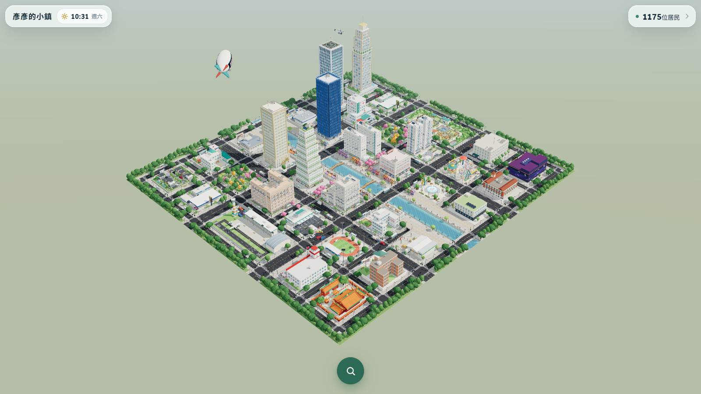
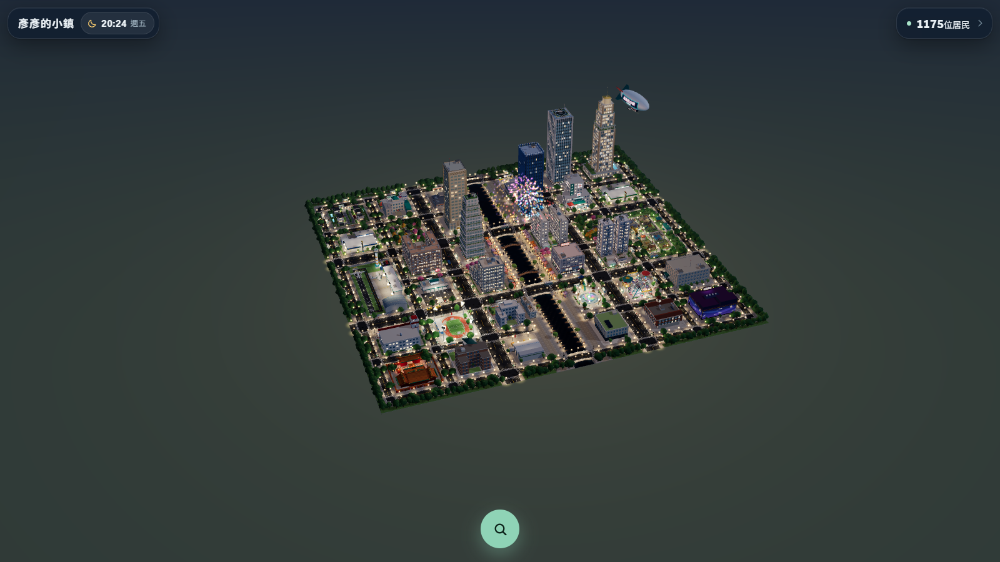
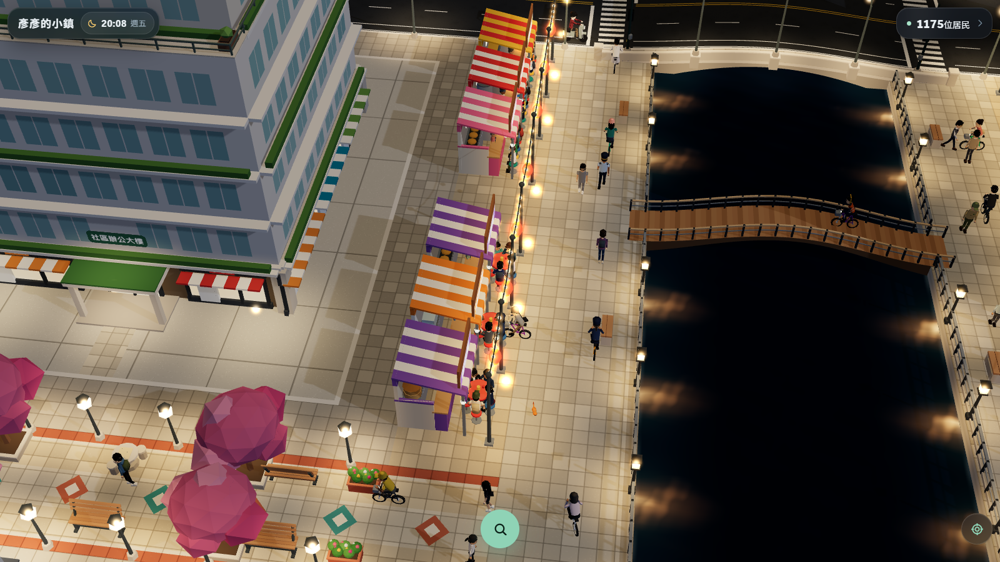
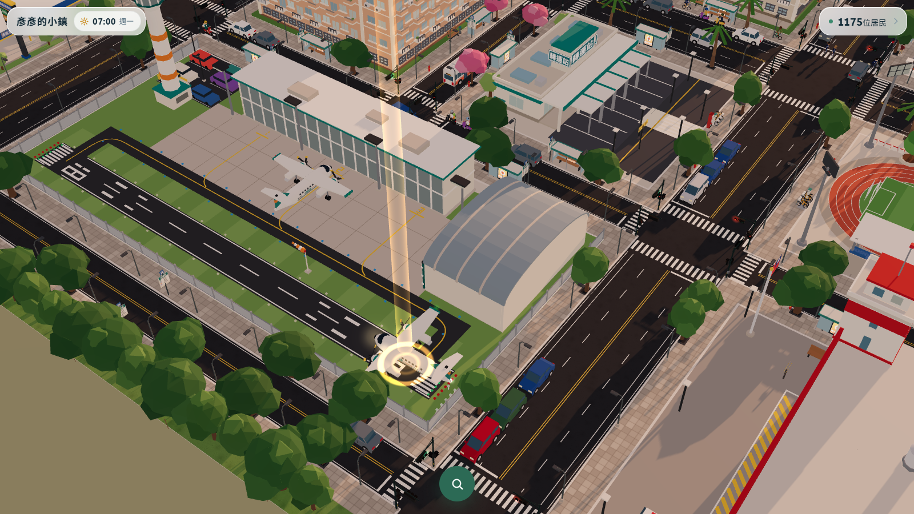
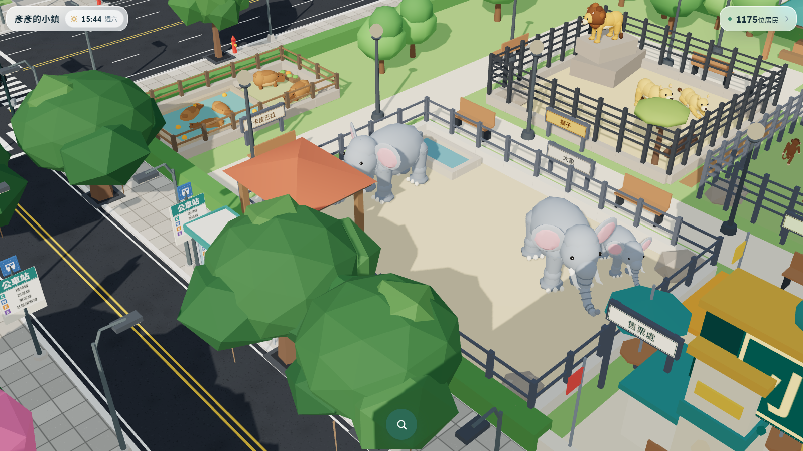
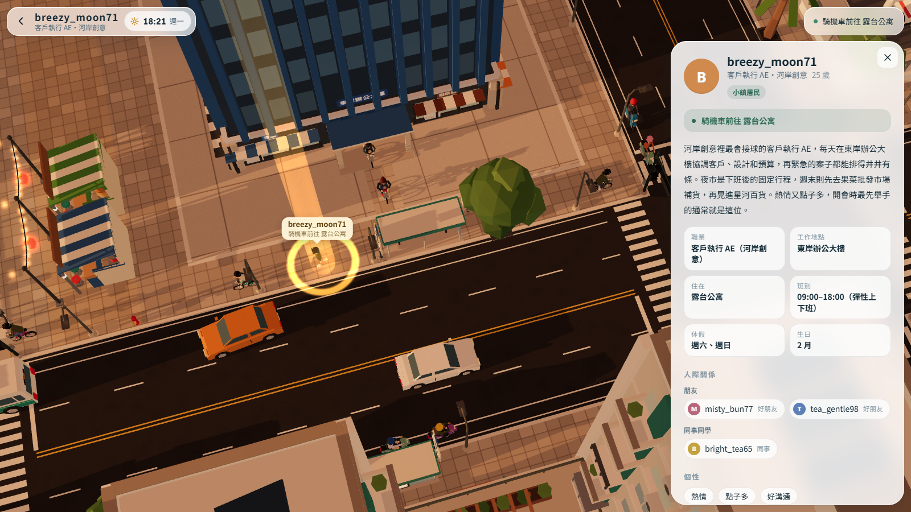
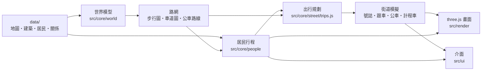

# 彥彥的小鎮 Yan's Little Town

[English](README.en.md) | **繁體中文**

**一座住著一千多位居民的小鎮，在你的瀏覽器裡即時過著每一天。**

每位居民都有自己的家、工作、家人和朋友，照著自己的行程過一週：早上出門上班上學，中午吃飯，下班去夜市，週末全家出遊。他們走路、騎腳踏車、騎機車、開車、搭公車或計程車，在路口等紅綠燈，在夜市坐下來吃東西，晚上回家睡覺。點任何一棟建築，看得到現在裡面有誰；點任何一位居民，看得到他今天的行程和人際關係，還能一路跟著走。



- **不需要建置、沒有任何相依套件**：純 HTML + JavaScript + three.js，任何靜態伺服器都能跑
- **1175 位居民、28 天不重複的行程**：每個人的一週都由規則推導出來，同樣的資料在任何瀏覽器都得到完全一樣的小鎮
- **有機場也有動物園**：小鎮航空的飛機每天起降 16 次，機上就是鎮上的機組員，飛出小鎮後在遠方慢慢淡出；動物園的大象、長頸鹿、卡皮巴拉等成群散步、原地午睡，閉園後躺下睡覺
- **真的會「走過去」**：每一趟出門都在真實路網上找路、算時間、準時抵達，而不是瞬間移動
- **有物理的街道**：跟車、紅綠燈、行人專用時相、禮讓行人、公車停靠、計程車共乘
- **所有東西都能改**：居民、家庭、地圖、建築、公車路線都在 `data/` 裡，改完重新整理就生效
- **純程序化美術**：沒有載入任何 3D 模型檔，人物、車輛、建築、煙火全部用程式畫出來，還有藍白拖、小黃帽、茄芷袋和鐵窗

---

## 目錄

- [快速開始](#快速開始)
- [畫面一覽](#畫面一覽)
- [小鎮導覽](#小鎮導覽)
- [居民：一千多個人的一週](#居民一千多個人的一週)
- [路網與路徑演算法](#路網與路徑演算法)
- [街道模擬：交通物理與號誌](#街道模擬交通物理與號誌)
- [畫面與效能](#畫面與效能)
- [介面與操作](#介面與操作)
- [打造你自己的小鎮](#打造你自己的小鎮)
- [開發](#開發)
- [關於居民資料](#關於居民資料)
- [授權與致謝](#授權與致謝)

---

## 快速開始

```sh
git clone https://github.com/yuyan7498/yans_little_town.git
cd yans_little_town
npm run serve        # 開啟 http://127.0.0.1:8123
```

- 只需要 **Node 22 以上**，而且只有開發伺服器、測試和工具會用到 Node；小鎮本身是純前端。
- 不想裝 Node 也可以：用任何靜態伺服器（例如 `python -m http.server`）打開資料夾即可。
- 手機也能玩：小觸控螢幕會自動切換成較輕的畫質。

### 網址參數

| 參數 | 作用 |
|---|---|
| `?day=6&minute=1230` | 直接跳到第 6 天（週六）20:30。`day` 從 1 開始，第 1 天是週一；`minute` 是 0–1439 |
| `?dayspeed=8` | 時間流速加快 8 倍（最多 60 倍） |
| `?quality=lite` / `?quality=full` | 強制使用手機畫質／完整畫質 |
| `?welcome=0` | 跳過歡迎畫面 |
| `?debug` | 把 `town`、`view`、`ui`、`world`、`people`、`street` 放到 `window` 方便除錯 |

沒有指定時間時，小鎮會記得你上次看到哪裡（存在瀏覽器的 localStorage），下次打開接著過。

---

## 畫面一覽

| | |
|---|---|
|  |  |
| **週五 20:24**：路燈亮起、窗戶隨著居民在家而亮、煙火在運河上空綻放 | **河岸夜市**：32 個攤位，居民坐下來吃東西，流浪貓橘子在攤位旁討食 |
|  |  |
| **小鎮機場**：點選正在起飛的小鎮一號，鏡頭會跟著它滑行、起飛、爬升離場；機上是當班的機長、副機長和空服員 | **小鎮動物園**：週六下午，母象帶著小象散步，公象在棚下吃乾草；後面是泡在溫泉池裡的卡皮巴拉（有一隻頭上頂著柚子），右上是岩石上的公獅 |



**跟隨居民**：點一位正在騎機車回家的居民，鏡頭會一路跟著；右邊的資料卡有他的工作、班別、休假日、人際關係、個性與今天的行程。

---

## 小鎮導覽

小鎮是一塊 596 × 552、接近正方形的地面，中間有一條南北向的運河。六條南北向大道、七條東西向街道交織成路網，東西兩側各有一排外圍地塊，左右對稱：

- **運河與河岸步道**：兩岸各有 12 寬的步道和欄杆燈籠，水面有動態著色器，夜裡映著燈籠的倒影
- **橋與隧道**：北外環路、北大街、南大街、南外環路以拱橋跨過運河；北環路與南環路鑽進運河底下的**隧道**（深度足夠讓公車通過，隧道內有照明）
- **兩座人行拱橋**：北人行橋、南人行橋
- **中央街行人徒步區**：兩條堤大道之間只有行人能走
- **外環路**：讓公車、貨車可以繞行全鎮而不卡死；西外環路、東外環路再把外圍地塊圍起來
- **佔兩個地塊的地標**：中央街只畫到東西環路，所以機場和動物園各佔兩個地塊

### 建築

| 類別 | 建築 |
|---|---|
| 住家 | 庭院住宅、花園大樓、露台公寓、雙塔社區（陽台、鐵窗、冷氣室外機、頂樓水塔一應俱全；四處住家**剛好住滿**），以及兩座豪宅：**雲頂別墅**（六棟附泳池的現代別墅、警衛亭）和 **天璽豪宅**（24 層、空中花園，頂冠夜裡會亮） |
| 學校 | 鎮東國小（附設幼兒園）、未來中學、小鎮大學 |
| 醫療 | 小鎮綜合醫院（急診入口停著救護車）、三間社區診所 |
| 購物・美食 | 星河百貨（LED 跑馬燈）、南巷商場（鐘樓）、**河岸夜市**、果菜批發市場 |
| 辦公 | 北區辦公大樓（頂樓停機坪）、銀行商務大樓、東岸辦公大樓、社區辦公大樓、鎮北銀行、**小鎮銀行總行**（石柱門廊、24 小時 ATM、得來速 ATM） |
| 公共服務 | 鎮公所、鎮立圖書館、鎮東派出所、清潔隊、**小鎮消防隊**（消防車、雲梯車、救護車和五層樓高的訓練塔） |
| 交通 | 轉運站、**小鎮機場**、**西區加油站**與**東區加油站**（油價看板、便利店、自動洗車；停在油槍旁的車就是正在加油的居民） |
| 產業 | 工匠工坊、鎮北物流中心 |
| 休閒 | 城市之光廣場、星光樂園、西岸公園、東岸公園、鎮民運動場、**小鎮動物園**、**星空影城**（跑馬燈和電影海報）、**鎮安宮**（燕尾脊、剪黏、天公爐和一排排紅燈籠） |

### 地標與每日活動

| 地標 | 內容 |
|---|---|
| 🏮 **河岸夜市** | 18:00–24:00 營業，運河兩岸共 32 攤（蚵仔煎、珍珠奶茶、鹽酥雞、章魚燒……還有射氣球），共 140 個座位。攤販老闆會固定顧職稱裡寫的那一攤，例如「滷味攤老闆」就顧滷味攤 |
| 🎆 **煙火秀** | 每晚 19:30–20:30 在運河上空施放，五種煙火（牡丹、環形、柳枝、爆裂、雙層）加上 13 發的壓軸齊射。每天的煙火都不一樣，而且是時間的純函數：把時間條拖回去，天空會重播一模一樣的煙火 |
| ⛲ **城市之光廣場** | 噴泉 06:00–23:00 運轉，18:30、20:40、22:00 各有一場 26 分鐘的彩色水舞 |
| 🎡 **星光樂園** | 16 個車廂的摩天輪（車廂永遠保持水平）、旋轉木馬、旋轉鞦韆、雲霄飛車，夜裡輪框有跑馬燈 |
| 🚁 **總統專機** | 總統每天搭直升機從北區辦公大樓頂樓起飛巡視三次（平日 08:40、13:10、16:50，週末 10:20、14:20、17:50），起飛、繞行、轉彎傾斜、降落全都依物理計算，可以點選跟隨 |
| ✈️ **小鎮機場** | 小鎮航空的兩架螺旋槳客機每天各飛四趟來回（07:00 起，往返澎湖、金門、台東、馬祖）：發動、後推、滑行、在跑道頭等待、起飛滑跑、收起落架爬升，飛出小鎮後在遠方的霧裡慢慢淡出，回程再從遠方慢慢出現，從南邊進場降落、滑回機位。夜裡有航行燈、閃光燈和落地燈。飛機可以點選跟隨，機上就是當班的機組員（飛機淡出時會自動取消選取）；週末有不少全家來看飛機 |
| 🦒 **小鎮動物園** | 09:00–17:00 開園：大象、長頸鹿、獅子、斑馬、河馬、卡皮巴拉、紅鶴和猴子各有自己的園區。小象跟在母象身邊，公象在棚下吃乾草；斑馬、繞著攀爬架追逐的猴子、泡在溫泉池裡的卡皮巴拉排成一圈一起走；午睡時間和閉園後，就在停下的地方躺下睡覺。保育員 07:30 就來餵動物，週末全家出遊的人最多 |
| 🎈 **廣告飛船** | 在小鎮上空繞圈，兩側寫著「彥彥的小鎮 / By 彥彥」，夜裡是霓虹燈 |
| 🏟️ **鎮民運動場** | 跑道、球場、看台，四座照明燈塔會隨著路燈一起亮起 |

---

## 居民：一千多個人的一週

小鎮有 **1175 位居民**：1173 個人，加上流浪貓「橘子」和流浪狗「黑輪」。

### 居民組成

| 身分 | 人數 | 一天大概怎麼過 |
|---|---:|---|
| 學齡前幼兒 | 48 | 平日由家長順路送到國小附設幼兒園，16:00 下課；週末午睡後讓大人推車去公園散步 |
| 國小學生 | 91 | 08:00–16:00 上課，四分之一放學去樂園玩，有的由祖父母到校門口接 |
| 中學生 | 63 | 07:30–17:00 上課，週一到週四晚自習（或固定去圖書館讀書），週五有人去逛百貨 |
| 大學生 | 77 | 每個人每天的課表形狀不同，過半數每週固定兩天去夜市吃晚餐，週末睡到十點 |
| 上班族 | 156 | 約 09:00–18:00，每人有自己的彈性上下班時間；每週一天加班，部分大樓隔週六上班 |
| 大樓大夜班 | 12 | 22:00–07:00 值夜，白天補眠 |
| 工坊、物流、市場工人 | 104 | 市場有清晨 04:00 的批發班和 07:30 的零售班 |
| 店員、攤販、加油站與影城人員 | 108 | 店員分早班、晚班；攤販 16:00 備料、18:00 開賣到 23:20；加油站、影城、廟方和動物園商店也都有人顧 |
| 司機 | 32 | 其中 19 位是公車司機，分早晚兩班，全年無休 |
| 機組員 | 18 | 六組（機長、副機長、空服員）輪流飛，每班兩趟來回，大約飛兩天休一天 |
| 機場地勤 | 14 | 早班 05:30 送走第一班飛機，晚班到 21:30 接最後一班 |
| 動物園保育員 | 10 | 07:30 開始餵動物，動物園天天開，輪流休假 |
| 老師、學校職員 | 37 | 國小、中學、大學各有不同的上班時間 |
| 醫師、護理師、醫院行政 | 60 | 醫師、護理師三班制（早班、小夜、大夜），小夜班有值班餐 |
| 警察 | 8 | 三班制，早班警察在上學日 15:15 到國小門口站**護學崗** |
| 消防員 | 15 | 三班制在消防隊待命，早班下午做消防演練 |
| 銀行行員、公所公務員 | 34 | 鎮北銀行週六上午半數輪值，隔週交換；小鎮銀行總行只開平日 |
| 清潔隊 | 10 | 清晨收垃圾；晚班收完垃圾還要在夜市收攤後清理河岸到 00:40 |
| 待業中 | 11 | 睡到十點，有人每週兩個下午去鎮公所排隊辦事 |
| 住院病人 | 6 | 一天兩次治療，下午在走廊散步 |
| 退休族、長輩 | 257 | 晨運、週二四六上市場、看診、下午在長椅下棋聊天，有人晚上跳廣場舞，也有人每週兩個上午去鎮安宮拜拜 |
| 鎮長、總統 | 2 | 手寫的專屬行程（見下方） |
| 流浪貓、流浪狗 | 2 | 不進建築，全鎮遊蕩（見下方） |

### 人際關係

- **333 個家庭**（夫妻、長輩同住、合租、單身），906 位居民屬於某個家庭
- **2591 組關係**：伴侶 170、老伴 111、親子 594、手足 215、祖孫 271、室友 56、好朋友 410、老朋友 176、同學 142、同事 429、照顧流浪動物 16，還有鎮長和未婚妻 1 組
- **41 組祖父母接送**、**127 個好朋友群**、**99 個老朋友圈**
- 介面上的稱呼（另一半、父母、同事……）都是中性用詞，**不會猜任何人的性別**；人物外觀也不是由性別決定，髮型、裙子或褲子、體型、顏色全部獨立隨機

### 一起出門的生活

居民不是各過各的。`src/core/people/together.js` 每天先替每個家庭、朋友圈決定共同行程，參加的人拿到**完全相同的分鐘數、地點和同一個 party 編號**，之後所有的時間微調都不會拆散他們；走路的時間以最慢的成員為準。

- **家庭日**：孩子和至少一位家長都有空時，週末有七成機會全家去樂園、動物園、百貨、影城、公園或廣場（也有人去機場看飛機），近半數晚上再一起去夜市
- **情侶日**：兩人都休假、孩子都滿 12 歲時，有一半機會一起去夜市吃晚餐，或下午出去走走、看電影、逛動物園
- **幼兒園接送**：同戶第一位「今天要上班、而且是辦公室／工坊／物流／銀行／公所／醫院行政」的大人順路送小孩，下班再順路接回；沒有這樣的大人時，由當天休假的家人或祖父母接送
- **祖父母接放學**：上學日 15:50 在校門口等，牽孫子一起走回家；如果孫子放學要去樂園，祖父母也會跟去（兩邊的行程問的是同一個雜湊，所以永遠一致）
- **週五好友聚餐**：每個好朋友群每三個週五有兩個一起吃晚餐，七成固定去夜市
- **老朋友圈**：退休族和長輩每週五個下午坐在離家最近、坐得下所有人的長椅上聊天；長椅若在棋桌旁就變成下棋。兩個圈子共用一張長椅時會錯開時段
- **鎮長約會**：鎮長和未婚妻每週一、三、五在夜市約會吃晚餐，週末整天一起逛廣場、百貨、夜市；未婚妻那幾天會自動避開加班
- **遛狗**：16 位養狗的居民每天早晚帶狗散步 20～40 分鐘，狗走在主人前面、有牽繩；退休的另一半會一起散步
- **夜市座位**：同行的人會坐在一起；位子坐滿了就站在攤位前。要繞過桌子才能到的位子，居民會真的繞過去

### 流浪貓「橘子」和流浪狗「黑輪」

牠們的窩在鎮公所前的河岸，一個是放了毛巾和小燈籠的紙箱，一個是紅屋頂的狗屋。

- **橘子**是夜貓子：白天在窩裡睡覺、曬太陽，19:00 前一定走到夜市向攤販討食（被餵的機率約三分之二），接著在全鎮夜遊，**凌晨兩三點才走回窩**
- **黑輪**早上五點起床，06:30 前到最近的公園或廣場等晨運的長輩餵早餐，白天全鎮閒晃，放學時間去校門口、樂園或廣場陪小朋友玩，21:30 回窩
- 遊蕩路線：地圖切成 4 × 8 格，每隻動物有自己洗牌過的格子順序、每天偏好其中 5 格，一週下來會走遍全鎮
- 牠們也有「照顧牠們的人」：攤販、退休族、學生、鎮長共 16 位

### 鎮長與總統

- **鎮長「彥彥」**：08:30–17:30 在鎮公所，週二、四下午輪流巡視市場、國小、公園、轉運站、醫院；每晚都在夜市結束一天，騎機車通勤
- **總統**：每天 07:45 進北區辦公大樓處理國事，每一趟直升機巡視都在機上，全年無休

### 機組員與外圍的新工作

- **機組員**：18 位居民排成六組，每組三人（機長、副機長、空服員），依 `src/core/world/flights.js` 的班表輪流飛：有班的日子提早到機場簡報、登機、飛兩趟來回、講評後回家。飛機從後推出機位到停回機位這段時間，點機組員會看到他們在飛機上，跟隨就會一路跟著飛機起飛、離場、返航、降落
- **加油**：自己開車的人每週有兩天下班順路（或休假日上午）去離家最近的加油站加油
- **拜拜、看電影、逛動物園**：長輩每週兩個上午去鎮安宮；學生、情侶和全家週末去星空影城或動物園

### 行程是怎麼產生的

行程不是逐人手寫，而是「**職業 → 日程範本 → 一連串調整**」：

1. **職業細分**：同樣是工人，依工作地點分成市場、物流、工坊；店員分成商店和夜市攤
2. **範本**：每種職業一個函式，輸出一列列 `[開始, 結束, 狀態, 地點代號, 活動]`，例如 `['08:00','12:00','AT_WORK','WORK','class']`
3. **共同行程**先排好（家庭日、接送、聚餐……）
4. **地點代號 → 實際地點**：`NIGHT_MARKET`、`MALL`、`CLINIC`、`BENCH`……依每個人的家找最近的（公園和廣場有 35% 會選第二近的，避免大家擠同一座）
5. **自然的時間差**：起床和吃飯時間 ±15 分、出門時間 ±30 分，上班族另有固定的個人彈性 ±30 分，整個小鎮不會同一秒出門
6. **路程撐開**：每一段路程都被撐到真實的門到門交通時間再加 8 分鐘餘裕，必要時推動前後的停留時間；睡眠不會少於約 6 小時
7. **休息中的地點**：行程指向打烊的地方（例如週日的銀行）會自動改成待在家
8. **人潮調度**：以 5 分鐘為單位統計每個地點的人數，可以改地點的行程依開始時間排隊，整群人一起改去第一個還有空位的地方（夜市可以擠到 130%）
9. 跨午夜的班別會切成兩段，第二天的行程從「接續昨晚的班」開始，而且只有昨天真的有上班才會接

**排休**也是自動的：商店員工連休兩天平日（所以週末永遠有人顧店），醫護、警察、司機連休兩天，同一個團隊的人輪流排開，確保每天都有人上班。

### 決定論：同一份資料，永遠同一個小鎮

`src/core` 裡**沒有任何一個 `Math.random`**。所有「隨機」都是對一個字串做雜湊（FNV-1a 再加一層 murmur 風格的混合），例如 `居民id:習慣名稱:第幾天`：

- `has`：長期的個性（每週都是同一批人）
- `today`：今天的心血來潮
- `onDays(n)`：每週固定 n 個平日
- `weekly`、`alternate`：每週同一天、隔天交替

所以同一份資料，在 Node、Chrome、手機上打開，每個人每一天做的事都完全一樣；測試 `plans are deterministic` 會檢查這件事。一些輪替是以週為單位（銀行週六輪值、週末值班、加班日、隔週六上班、鎮長巡視三週一輪），所以驗證工具會把 **28 天** 全部排一次。

### 誰在哪裡、窗戶為什麼會亮

- `occupancy(day, minute)` 對 1175 份行程做二分搜尋，得到每棟建築此刻裡面有誰、幾人醒著、幾人在上班；點建築看到的名單就是它
- **窗戶的亮燈比例來自真正在家而且醒著的居民**：凌晨大部分窗戶是暗的，但約 6% 的住家會有人熬夜；有大夜班的辦公大樓半夜仍有燈

### 每位居民的小檔案

每位居民都有一段簡介，加上個性、興趣、口頭禪、最近的小目標，和一個要點一下才看得到的**小祕密**。

---

## 路網與路徑演算法

### 從地圖到圖

`data/town.js` 是唯一記載座標的檔案，世界模型（`src/core/world/build.js`）從它推導出所有東西：

| 項目 | 數量 |
|---|---:|
| 路網節點 | 74（40 個路口） |
| 路段 | 100（4 段在橋上、2 段在隧道） |
| 有號誌的路口 | 32 / 40（外圈四角是彎道，舊外環的四個轉角車少、不設號誌），外加 8 處有號誌的路段中行人穿越道 |
| 斑馬線 | 140 條路口斑馬線 + 8 條路段中斑馬線 |
| **步行圖** | 488 節點、638 條邊（人行道 462、斑馬線 148、河岸步道、人行橋……） |
| **車道圖** | 與路網共用 74 節點，98 條雙向路段（196 條有向弧） |
| 公車站 | 120 個站位、86 支站牌，其中 62 個有候車亭 |

右側通行，沒有單行道。車道位置由道路寬度推算：汽車走內側或外側車道，機車和腳踏車貼著路邊走。

### 走路：從每扇門出發的 Dijkstra 樹

- 步行圖以 **CSR（壓縮稀疏列）** 的 typed array 儲存，優先佇列是重複使用的**二元最小堆積**，搜尋時不配置任何記憶體
- 每扇門建一棵正向、一棵反向的 **Dijkstra 最短路徑樹**並快取；之後任何一對門之間的路線都是 O(1) 查表
- 起點可以在一條邊的中間：兩端節點各自帶著部分成本入堆
- **成本** = 長度 × 靠右係數 + 斑馬線懲罰
  - 走在人行道的「錯邊」多算 3%（`KEEP_RIGHT = 0.03`），所以行人會自然靠右
  - 每穿越一條斑馬線加 10 單位（`CROSS_PENALTY = 10`），行人不會為了省一點點路而來回穿越馬路
- **只走斑馬線**由三層保證：
  1. 建圖時人行道在每個車道路口處被切斷，只能經由斑馬線相連
  2. 從門口接上路網時，用 Liang–Barsky 線段裁切檢查不會跨越車道
  3. 測試把每條路線每 0.5 單位取樣一次，確認沒有人踩上車道
- 圖這麼小，A* 沒有必要；Dijkstra 加快取已經夠快

### 開車：點對點 Dijkstra 與路邊停靠

- 從「路邊的某一點、面向某個方向」出發，到「另一個路邊點」為止，到達即停止搜尋；起點和終點都禁止原地迴轉，必要時會繞一圈街廓
- **在哪裡上下車**：每扇門取 110 範圍內的候選路邊（步行最近的一側、同一條路的對側、另一條路上最好的一處），所有起訖組合都試一遍，分數 = 開車成本 + 12 × 步行距離
- **路邊停車格**：可停靠的路段切成 6.5 長的格子，公車站附近不設格；每四格有一格保留給計程車。每次停靠都在帳本上預約時間窗，格子滿了就換到多走不超過 30 單位的另一處，預約到之後再用實際的格子重新規劃路線
- **選車道**：路線先合併成每條路一段，判斷每個轉彎是左轉、右轉或直行；左轉前切到內側車道，直行、右轉或最後一段要靠邊停時走外側，換車道的地點選在最晚一個不碰到路口與斑馬線的位置

### 會避開塞車的路線規劃

每條**有向**路段都有一份以 10 分鐘為一格的全天流量表（145 格，`Float32Array`）：

```
路段成本倍率 = 1 + 2 × (流量 / 容量)²        ← 類似 BPR 壅塞函數
流量         = 本格 + 前後兩格各一半
容量         = 0.25 × 速度倍率 × 車道數
```

一天的所有出行**依抵達時間排序後逐一指派**：每排好一趟就把它佔用的路段寫回流量表，後面的人自然會繞開前面的人塞住的路。要讀哪一格的流量，是先用不塞車的速度估出「大概會在路上的哪個時間」再決定。機車只算 0.35 台車。

### 選擇交通方式

| 距離 | 選擇 |
|---|---|
| 110 以內，而且走得到 | 走路（帶狗的人和流浪動物永遠走路） |
| 280 以內 | 一起出門的人都騎車、而且自己是單車愛好者（約 55%）或平常就騎車 → 腳踏車 |
| 其他 | 依身分決定的「平常用的交通工具」：上班族約 52% 機車、24% 汽車、14% 公車、10% 腳踏車；長輩 65% 公車、20% 計程車、15% 家人開車；國小學生 30% 家人開車、70% 公車；鎮長永遠騎機車 |

三人以上同行優先汽車、公車或計程車；兩人優先機車或公車。候選清單裡第一個「時間來得及」的方式勝出。腳踏車走的是步行路網。

以平日為例，一天約 **2,900 趟出行**：腳踏車約 910、機車約 870、汽車約 400、走路約 340、家人開車約 160、計程車約 100、公車約 90。

### 準時抵達：從抵達時間往回推

1. 排行程時先用一個**與行程無關的門到門時間估計器**預留交通時間（含等紅燈、等公車的餘裕）
2. 實際出門時**盡量晚出發**：出發時間 = 目標抵達時間 − 需要的時間，最多提早 45 分鐘（搭公車 100 分鐘）
3. 需要的時間包含：開車以 1/1.3 的速度估算、每個有號誌路口 +2.8 分、無號誌 +0.6 分；走路和騎車每組號誌路口 +6 分；叫計程車預期等 4 分
4. 時間不夠時，走路最多加速 1.3 倍、騎車 1.15 倍、開車 1.2 倍；再不夠就寧可遲到，也不會飆車

實測平日遲到超過 5 分鐘的出行約 3.7%，週末約 2.5%。

| 移動方式 | 速度（單位／小鎮分鐘） |
|---|---:|
| 走路 | 1.625 |
| 腳踏車 | 5.5 |
| 機車 | 9（× 3） |
| 汽車、計程車 | 11（× 3） |
| 公車 | 時刻表 9、巡航 11（× 3） |
| 貓／狗 | 2.6 / 2.4 |

走路和騎車保持真實比例（腳踏車約是走路的 3.4 倍），機動車輛則再乘上 `PACE = 3`，讓車流在縮小的小鎮裡看起來合理。

### 公車、計程車、貨車與警車

- **5 條公車路線**：環河線、西區線、東區線、社區接駁線，以及繞外圍地塊的外環線，由路口串成環狀，可雙向行駛（依環線的有號面積判斷是外圈還是內圈）。公車站設在每段 60 以上的平地路段中間，不設在橋上和隧道坡道
- **公車司機也是居民**：早班 05:45–13:30、晚班 13:00–21:00，依車隊順序上線，同一條路線的車平均錯開發車。乘客走到 105 範圍內最近的站牌，搭「最晚一班還能準時到的車」，不轉乘
- **公車只停有人上下車的站**：先下後上，會多等 1.5 分鐘給正在跑過來的乘客
- **計程車**：同一個起訖點的乘客共乘（最多 3 人）；派最近的空車，並算好時間讓車子在乘客走到路邊前約 0.4 分鐘抵達；載完客接最早的叫車，沒有就回轉運站排班
- **送貨車**：4 輛，07:00–18:00，每趟送 3～5 個客戶，夜市 14:00 後才送；卸貨時打**雙黃燈**
- **警車**：2 輛 24 小時在各地標之間巡邏
- **飛機**：和總統專機一樣，位置是時間的純函數（`src/core/world/flights.js`），把時間條拖回去會重播一模一樣的起降；飛到地圖邊緣外 40 單位開始淡出，640 單位外完全消失（以一般速度約 9 秒）

### 效能（開發機實測）

| 步驟 | 時間 |
|---|---:|
| 建立世界模型 | 4.2 ms |
| 建立路網 | 4.1 ms |
| 建立公車路線 | 3.0 ms |
| 1722 條建築間步行路線（冷快取） | 24 ms |
| 一整天 1175 位居民、約 2,900 趟出行的規劃 | 約 510 ms |

---

## 街道模擬：交通物理與號誌

### 核心概念：時刻表 + 物理

這不是讓每個人自由亂走的模擬。行程和出行規劃已經決定了「**現在**每個人應該在自己路線上的哪裡」；物理層只負責決定他**安全地**能前進多少。被擋住的人之後會稍微加快（走路 1.3 倍、車輛 1.2 倍）追回時刻表。

每一步分兩階段：先讓所有人根據**上一步**的位置做決定，再一次全部提交，所以處理順序永遠不影響結果。

### 車輛

- **跟車模型**：類 Gipps 的安全停車模型。速度 = min(想要的速度, 能在限制點前平穩停下的速度, 速限, 目前速度 + 加速度 × dt)，跟隨移動中的前車時會把前車自己的煞車距離也算進去
- **加速度依車種**：汽車 5.5、機車 7、腳踏車 4、公車 3.5、貨車 5
- **起步不抖**：前方要持續空出一小段時間（或前車已經在動）才起步
- **機車鑽車縫**：沒有特別寫這段程式。機車走路邊的車道線，並排但不碰到的車體視為不衝突，所以機車會自然從停等的車陣旁邊鑽過去
- **路邊起步**：要等到一段包含後方來車煞車距離的空檔；等太久就往前找位置，並在車道上放一個「幽靈預約」，讓後面的駕駛留空隙給它

### 路口

- 路口是一個**預約制的區域**：最前面的車提出申請，依等最久、再依最近的順序核准
- **掃掠路徑檢查**：兩台車穿過路口的路徑以 1 單位為間隔取樣，兩兩檢查是否碰撞；同車道同方向、或平行車道不碰觸的不算衝突
- **不堵塞路口**：出口另一端沒有空間就不進去，停在斑馬線前 1.6 的地方等
- **黃燈兩難區**：黃燈時只有「已經來不及停下」的車才繼續通過
- **無號誌路口**依需求輪流放行

### 紅綠燈與行人專用時相

- 南北向、東西向輪流放行（綠 → 黃 → 全紅），加上**行人專用時相**：所有車輛停下，行人可以走所有斑馬線
- **感應式號誌**：沒有人在橫向等待就保持綠燈；還有車在 30 單位內接近就延長綠燈；全紅持續到路口淨空
- 行人時相只在所有斑馬線和路口內都沒有車時才開始，綠色小人會在行人時相結束前**加快腳步並閃爍**，直到最後一個人走完
- 行人在路緣等待並按鈕；一離開路緣就會走完全程，而且在斑馬線上以 1.5 倍速度補回等待的時間

| 參數（小鎮分鐘，× 0.625 = 真實秒數） | 值 |
|---|---:|
| 最短／最長綠燈 | 1.7 / 7 |
| 黃燈 | 0.8 |
| 全紅 | 0.3–1 |
| 行人綠燈 + 閃爍 | 1.3 + 0.6～2.4 |

### 行人群體

- 行人有連續的橫向偏移，會被旁邊的人推開；迎面而來時雙方都靠右
- 遇到燈柱、樹、長椅會從較近的一側繞過去，並一直保持在那一側直到通過
- 門口附近和有車時會縮成靠右的單行，進出的人可以錯身；學校、醫院這類有圍牆的寬大校門則並排進出，不會在門口擠成一團
- **一起出門的一群人是一個物理個體**：並肩走，超過三人就兩兩一排；騎車時排成一列
- 腳踏車使用人行道網路和行人時相

### 不會卡死

逐層升級的解套機制：同時認為對方在前面時以 id 決定誰先走 → 禮讓超過 3 分鐘就強行通過 → 在路口等橫向車超過 4 分鐘、而且對方停著不動就放行（對方還在開就繼續等，最多 8 分鐘）→ 變燈時剛好壓在斑馬線上的車，路口淨空就先開進路口，不會停在斑馬線上擋住行人 → 被不動的東西擋住 10 分鐘就從旁邊鑽過 → 行程結束 40 分鐘還在路上的人直接移除。畫面端再做朝向和姿勢的平滑，避免抖動。

### 拖動時間條

時間往回跳、或往前跳超過 4 分鐘時，所有人直接放到時刻表上的位置，把重疊的人沿路線往後推開，再**預先模擬 12 分鐘**，讓你落地時路口已經有排隊的車和等紅燈的人。連續拖動時間條時會略過預模擬，保持流暢。公車上的乘客會被放回正在兩站之間的那班車上。

### 內建稽核

打開 `?debug` 後，在瀏覽器主控台：

```js
street.audit()       // 碰撞、車輛停在斑馬線上、等待原因、行程延遲、每千幀的抖動指標
street.stuckAudit()  // 落後時刻表卻停著不動的車，順著「被誰擋住」追到根本原因
```

兩者都在**街道的複本**上執行，不會干擾畫面。實測所有稽核中，行人時相期間**停在斑馬線上的車輛為 0**，車輛的六項抖動指標皆為 0。

### 效能

只有正在外面的人才是物理個體，早上尖峰約 300 個。穩定運作後每一步都不配置記憶體（物件池、重複使用的 `Float64Array` 緩衝區、`WeakMap` 快取）。開發機上早上尖峰約 300 個移動者時，每幀街道模擬中位數約 **1.3 ms**。

---

## 畫面與效能

### 天空與光

- **一天 15 分鐘**：一個小鎮分鐘是 0.625 真實秒（96 倍速）。日出 05:30–07:00、日落 18:30–19:30，路燈 18:20 亮起
- **銀河**：使用 ESO 的全天銀河全景圖，依**真實的銀道座標**放置，並隨著恆星時旋轉，21:00 前銀河中心會在正南方；上面再疊一層會閃爍的程序化星空
- **月亮**有月海紋理和臨邊昏暗，傍晚從東方升起
- **陰影**跟著視角配置，中心對齊整數像素，所以陰影不會閃爍；日月交替時兩者都很暗，陰影不會突然跳動
- 霧色與地平線一致，小鎮邊緣自然融入天空

### 夜景照明

所有光源（路燈、建築立面、夜市燈串、招牌）都畫進**一張俯視的光照貼圖**（半浮點，完整畫質 1024²、手機 512²），只在光源亮度改變時（黃昏與清晨）重畫。每個材質修補成每個像素讀一次這張圖，所以**不管有多少盞燈，成本都固定**，牆面也會被前方的光照亮。遠處的燈頭用最小像素尺寸的加法看板繪製，全景下仍然閃閃發亮。

### 人物、動物與車輛

- **完全程序化**：外觀由身分、年齡、職業和居民 id 的雜湊決定，每個特徵用獨立的鍵，新增特徵不會打亂其他特徵
- 20 種身分造型，加上鎮長（藍綠色西裝外套、紅領帶）和總統；台灣細節：幼兒園小黃帽、學校運動服、藍白拖、病人服加點滴架、紅白藍茄芷袋、反光背心的警察、橘色背心的清潔隊；機長的大盤帽和金色肩章、空服員的絲巾、地勤的反光背心和耳罩、保育員的遮陽帽、消防員、加油員和廟公也各有制服
- 身高隨年齡、頭髮隨年齡變白、七十歲以上微微駝背
- 17 根骨骼的低多邊形人物，所有人物烘焙進同一個緩衝區，骨骼矩陣每幀寫進浮點貼圖、在頂點著色器做蒙皮，**整群人一個 draw call**
- 姿勢：走路、站立、騎機車（戴安全帽）、後座乘客、騎腳踏車（踏板會轉）、坐長椅、坐板凳、下棋、在夜市吃東西
- 七種狗（台灣犬、柴犬、柯基、拉不拉多、貴賓……）、流浪貓與流浪狗
- 機車、腳踏車、三種汽車、計程車、公車（LED 路線牌）、警車（紅藍警示燈）、送貨車，每種一個 instanced mesh；小鎮航空的兩架螺旋槳客機（螺旋槳會轉、起落架會收放）
- 動物園的 31 隻動物：每隻是一棵關節樹（象鼻分節捲曲、大象的膝蓋、長頸鹿的鬃毛和斑紋、斑馬條紋、紅鶴的 S 形脖子），全部零件都是 9 種基本形狀的 instance，整個動物園 9 個 draw call。走路用小鎮的時鐘，午睡和夜裡就停在原地躺下，所以從不會走向床位時穿過別的動物；`tools/zoo-clip.mjs` 檢查一整天每個時刻（獨自活動的動物檢查所有位置組合），不會插進彼此、地面、圍欄、水池或擺設

### 畫質與預算

| | 完整畫質 | 手機畫質（`lite`） |
|---|---|---|
| 自動選擇 | 桌機 | 觸控為主或螢幕短邊 < 600 px |
| 陰影貼圖 | 4096，每幀更新 | 2048，每 1/8 秒更新 |
| 光照貼圖 | 1024² | 512² |
| 銀河貼圖 | 6000 × 3000 | 3072 × 1536 |
| 人物上限 | 560 | 360，省略鼻子、耳朵、眼鏡等細節 |
| 煙火閃光照亮全鎮 | 有 | 無 |

效能預算（`docs/CONVENTIONS.md`）：桌機 60 fps、手機 30 fps；全景最多 300 個 draw call、150 萬個三角形；每個人物少於 1000 個三角形。地圖擴大、居民增加到 1175 位之後，完整畫質的白天全景約 260 個 draw call、190 萬個三角形（街上的人物約佔四成，動物園的動物約 9 萬），三角形已超過預算；手機畫質（390 × 844）約 250 個 draw call、160 萬個三角形，動物改用較少面數的形狀、不投射陰影。鏡頭沒照到動物園時不畫動物。

---

## 介面與操作

| | 滑鼠 | 觸控 |
|---|---|---|
| 移動 | 左鍵拖曳（游標下的地面跟著游標） | 單指拖曳 |
| 縮放 | 滾輪（以游標為中心） | 雙指縮放 |
| 旋轉、傾斜 | 右鍵／中鍵拖曳，或 Shift + 拖曳 | 雙指旋轉；雙指一起上下滑動傾斜 |
| 選取 | 點建築、居民或車輛 | 點擊（觸控有較大的點擊範圍） |

鍵盤：`/` 或 `Ctrl/Cmd + K` 搜尋、`Esc` 依序關閉面板、方向鍵移動、`+` `-` 縮放。

- **歡迎畫面**：一座 SVG 迷你小鎮自己蓋起來，吊車會一直吊樓板直到真正的小鎮準備好
- **日夜主題**：介面在白天是淺色、晚上自動切換成深色
- **時間面板**：點時間開啟，拖動顏色跟著天空變化的時間條，切換星期、前後一天
- **搜尋**：用居民名字（大小寫、點、底線打錯也找得到）、職稱、職業類別、任職單位或建築名稱搜尋；沒輸入時列出各建築此刻的人數
- **建築面板**：此刻在裡面的人，人多時依職業分組
- **居民資料卡**：工作、班別、休假、生日、人際關係（點一下跳到那個人）、個性、興趣、口頭禪、小目標、小祕密，和標出「現在」的今日行程
- **跟隨鏡頭**：跟著居民走、跟著公車開、跟著直升機和飛機飛；居民走進建築時鏡頭框住那棟建築，被建築擋住時自動抬高視角，鏡頭永遠不會卡進建築裡
- 支援 `prefers-reduced-motion`、手機安全區域、Safari 觸控板手勢

---

## 打造你自己的小鎮

所有可以調整的內容都在 `data/`，**改完重新整理頁面就生效，不需要改程式**。

| 想做的事 | 改哪裡 |
|---|---|
| 新增、刪除居民，換工作、搬家，誰有養狗（`dog` 欄位） | `data/residents.json` |
| 家人、朋友、同事、結伴出門、誰照顧流浪貓狗 | `data/relations.json` |
| 居民的介紹、個性、興趣、小祕密 | `data/profiles.json` |
| 把兩棟建築對調、換地塊 | `data/town.js` 的 `lots`（對調兩個 id 即可；`'A3+A4'` 這樣的鍵代表一棟建築佔兩個地塊） |
| 道路、河道、橋、隧道的位置與寬度 | `data/town.js` |
| 夜市攤位、煙火時間、直升機航班、飛機班表與機組數、流浪貓狗的窩 | `data/town.js` |
| 建築的名稱、類型、容量、營業時間 | `data/buildings.js` |
| 公車路線、班距、計程車 | `data/transit.js` |
| 各種居民出門、吃夜市的比例等習慣 | `src/core/people/rules.js` 最上方的常數 |

一位居民長這樣（一人一行）：

```json
{"id":"office-012","name":"bear_clover87","age":25,"role":"office","job":"會計師","family":"firm","org":"誠信會計師事務所","home":"h-point","work":"t-four","hangout":"c-plaza","birthMonth":10}
```

改完先檢查：

```sh
npm run check            # 檢查資料：每個錯誤都用中文說明是哪位居民、哪個欄位不對
npm run check -- --plans # 再把 1175 位居民 28 天的行程全部排一次並驗證（約 1.5 秒）
```

檢查器會抓出：住家超過容量、孩子比父母年長、非早班的警察被排去站護學崗、一個人有兩位伴侶、指向不存在的地點、跨午夜的班別銜接錯誤……等等。

完整的欄位說明、怎麼新增居民、怎麼加一隻新的流浪動物，見 [`data/README.md`](data/README.md)。

---

## 開發

### 專案結構

```
data/          可編輯的資料：地圖、建築、居民、關係、介紹、公車
src/core/      純邏輯（可在 Node 執行）：時間、世界模型、居民行程、路網、出行、街道模擬
src/render/    three.js 畫面：場景、地面、建築、地標、車輛與街道設施、人物與動物
src/app/       介面使用的小鎮介面（town facade）
src/ui/        歡迎畫面、狀態列、面板、搜尋、資訊卡、鏡頭與手勢
src/main.js    啟動
tools/         開發伺服器、截圖、模組預覽、資料檢查
test/          node --test 測試
docs/          架構、模組介面、開發規範
vendor/three/  three.js r180（未修改）
```



- [`docs/ARCHITECTURE.md`](docs/ARCHITECTURE.md)：各部分怎麼接在一起、每一格畫面怎麼產生
- [`docs/CONTRACTS.md`](docs/CONTRACTS.md)：每個模組的介面與資料格式
- [`docs/CONVENTIONS.md`](docs/CONVENTIONS.md)：座標、比例、畫面風格、效能預算

### 指令

```sh
npm run serve            # 開發伺服器（無快取），http://127.0.0.1:8123，可用 --port 或 PORT 更改
npm test                 # 全部 116 個測試
npm run check            # 檢查資料
npm run shot -- "/index.html?welcome=0&minute=1290" .shots/night.png   # 截圖（需先啟動伺服器）
```

- **測試**涵蓋：行程決定論、28 天驗證（含午夜銜接）、容量、鎮長約會同步、總統每趟都在機上、飛機每個起降階段、淡出與機組輪班、動物園的動物從不穿模、合併地塊、幼兒園接送、流浪動物、遛狗、只走斑馬線、靠右走、停車格不重複預約、公車路線不離開路面、一天的規劃少於 1.5 秒、每幀街道模擬少於 4 ms、60 fps 下的抖動指標……
- **截圖工具** `tools/shot.mjs`：用無頭 Chrome／Edge 與軟體 WebGL（SwiftShader）截圖，不需要 GPU；直接走 DevTools 協定，不依賴 Puppeteer。支援 `--size`、`--eval`、`--wait-for`、`--mobile`
- **閃爍檢查** `tools/zfight.js`：找出位在同一平面、互相重疊的面（鏡頭移動時會閃爍），例如 `npm run shot -- "/tools/preview.html?m=src/render/buildings/commercial.js&ground=0" .shots/zf.png --eval "import('/tools/zfight.js').then(m => m.report(window.preview.scene))"`
- **穿模檢查** `tools/zoo-clip.mjs`：讓動物園的動物走過一整天，找出插進彼此、地面、圍欄、水池或擺設的時刻，例如 `node tools/zoo-clip.mjs elephant --step 1`
- **單一模組預覽**：每個畫面模組都能單獨看，例如 `/tools/preview.html?m=src/render/landmarks/market.js&minute=1290`；人物有 `view=lineup|crowd|rows`，號誌有 `stage=ns:green`，動物園的動物一字排開（站、吃草、走路、躺下）是 `?m=src/render/landmarks/zoo-herd.js&ground=0`
- **介面開發**：`/tools/ui-dev.html` 用簡化的方塊建築和模擬資料驅動真正的介面
- **除錯**：網址加 `?debug`，主控台可以用 `view.info()` 看 draw call、三角形數、fps

### 參與貢獻

歡迎 issue 和 pull request！送出前請先跑過 `npm test` 和 `npm run check -- --plans`。

---

## 關於居民資料

**小鎮裡的居民都是虛構的。** 居民名稱是程式合成的帳號風格暱稱（像 `bear_clover87` 這樣），簡介、職業、年齡、家庭與人際關係也都是虛構設定，不對應任何真實人物；若與現實中的帳號或人物雷同，純屬巧合。專案中沒有任何連結到社群網站的功能。

唯一的例外是鎮長「彥彥」，也就是這個專案的作者本人。

---

## 授權與致謝

- 本專案以 [MIT License](LICENSE) 授權
- [three.js](https://threejs.org/) r180（MIT），位於 `vendor/three/`，未經修改
- 銀河全景圖：ESO/S. Brunier，[CC BY 4.0](https://creativecommons.org/licenses/by/4.0/)，來源 <https://www.eso.org/public/images/eso0932a/>
- 小鎮的構想受到 [thousand-town（千人小鎮）](https://github.com/YiHuiShiBY/thousand-town) 啟發；本專案的程式碼、模型與資料皆為重新撰寫

第三方元件的完整授權資訊見 [`THIRD_PARTY_NOTICES.md`](THIRD_PARTY_NOTICES.md)。
